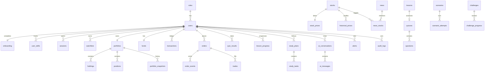

# Entity Relationship Overview

## Write paths (who mutates what)

| Table | Written by |
|---|---|
| stocks | `securityMaster.worker` only |
| stock_prices, indices, market_status | `marketSync.worker` / realtime service |
| historical_prices | historical service (cache-through from providers) |
| orders, order_events, trades | order service + matching engine |
| holdings, positions, funds, transactions | portfolio engine (in the same DB transaction as the trade) |
| user_skills, lesson_progress, quiz_results | learning engine |
| market_rules, market_config | admin service (+ audit_logs row) |
| news, news_stocks | `newsSync.worker` |
