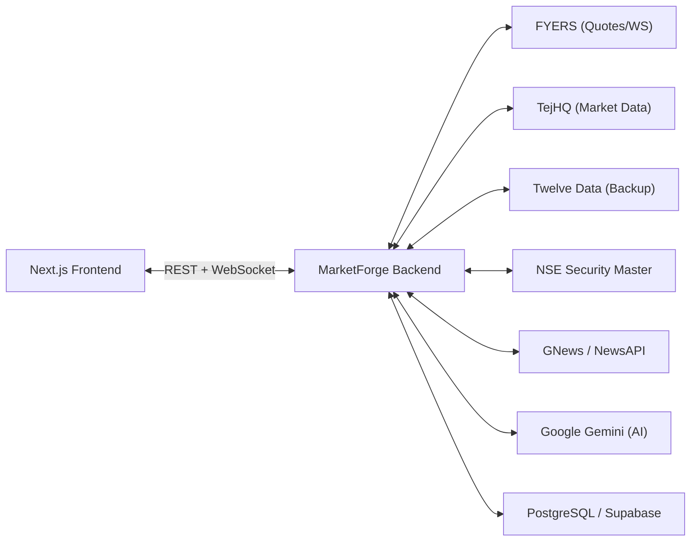

# MarketForge Architecture & Design Principles

MarketForge is a production-quality full-stack Indian stock-market learning and virtual trading platform.

> [!IMPORTANT]
> **MarketForge is NOT a real-money brokerage.**
> It is an educational simulator, virtual trading cockpit, and financial literacy platform.

---

## 1. Core Architectural Pillars

### Pillar A: Zero Direct Third-Party Frontend Calls
The frontend **never** connects directly to TejHQ, FYERS, Twelve Data, GNews, NewsAPI, or Google Gemini.
All external communications flow through the MarketForge backend. The backend normalizes provider responses into a consistent, shared internal schema (`@marketforge/shared`).

---

### Pillar B: Critical Risk Mandate (Rule 9)
**AI models (Google Gemini) MUST NOT calculate financial risk numbers.**

1. All calculations are executed by pure, deterministic TypeScript/JavaScript engines:
   - Order estimated value & statutory charges
   - Cash buffer and post-order liquidity
   - Single-stock concentration % and sector concentration %
   - Stress test simulations: potential loss at -5% and -10%
   - 30-day historical annualised volatility
   - Composite risk score (0-100) and rule violations
2. The AI assistant receives these pre-computed numbers under an authoritative `"grounding"` context and **only explains** their pedagogical meaning in plain natural language.

---

### Pillar C: Full NSE Security Master Universe
MarketForge is not hardcoded to a few arbitrary stocks (Reliance, TCS, etc.).
The security master worker (`securityMaster.worker.js`) synchronizes the complete universe of equities listed on the **National Stock Exchange of India (NSE)** directly from `EQUITY_L.csv`, enriched with sector and industry classifications from NSE index constituent lists.

---

## 2. Normalized WebSocket Architecture

The backend receives streaming market feeds from providers and maps them into canonical MarketForge events:

| Event Name | Scope | Description |
|---|---|---|
| `price:update` | `market`, `symbol:<SYM>` | Real-time last traded price (LTP), day high/low, change |
| `market:status` | `market` | Pre-open, Open, Closed, or Admin-Halted session status |
| `order:update` | `user:<USER_ID>` | Lifecycle transitions (OPEN, FILLED, CANCELLED) |
| `trade:executed` | `user:<USER_ID>` | Matched executions with average price and fee ledgering |
| `portfolio:update` | `user:<USER_ID>` | Portfolio valuation and equity balance refresh signal |
| `news:new` | `news` | Ingested financial news headline and sentiment |
| `alert:new` | `user:<USER_ID>` | Triggered price limit or risk violation notification |
| `sync:update` | `system` | Background worker sync milestones |
| `system:status` | `system` | Heartbeats and server connection health |

---

## 3. Deterministic Engines

1. **`riskEngine`**: Evaluates proposed orders against configurable rules (`maxPositionPct`, `maxSectorPct`, `maxDailyOrders`, `highVolatilityThresholdPct`).
2. **`matchingEngine`**: Simulates limit order matching, market order execution with realistic slippage (basis points), and stops rounded to the standard NSE tick size (₹0.05).
3. **`portfolioEngine`**: Computes weighted average buy prices, realized and unrealized P&L, sector allocations, and Herfindahl-based diversification health scores.
4. **`learningEngine`**: Grades quizzes, updates exponential moving average (EMA) skill scores, evaluates challenge criteria, and generates personalized study plans.
5. **`whatIfEngine`**: Backtests lump-sum vs. SIP dollar-cost averaging during historical market shocks (e.g. March 2020 crash).
